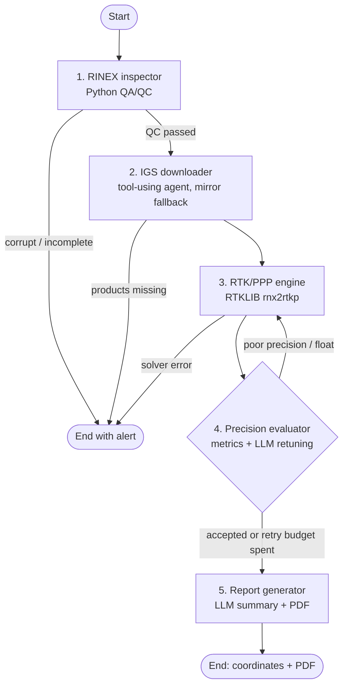

# GNSS Agent Pipeline

Automated GNSS processing: drop a RINEX observation file, get precise coordinates
plus a PDF report. A LangGraph state machine runs five nodes; LLM agents handle the
parts where judgement helps (product hunting, filter retuning, reporting), with
deterministic fallbacks so the pipeline runs without an API key.



## Layout

```
src/gnss_pipeline/
├── settings.yaml            # all thresholds, mirrors, product names, RTKLIB options
├── config.py                # settings loader (YAML override + env vars)
├── state.py                 # PipelineState shared by all nodes
├── graph.py                 # LangGraph wiring + routing functions
├── pipeline.py              # run_pipeline(): entry point for CLI and API
├── cli.py                   # gnss-pipeline run | qc | serve
├── gnss_time.py, geodesy.py # GPS week/DOY, ECEF<->LLH, ENU covariance
├── nodes/
│   ├── rinex_inspector.py   # 1. decompress, de-Hatanaka, QA/QC
│   ├── igs_downloader.py    # 2. Claude tool-use agent + deterministic fallback
│   ├── rtk_ppp_engine.py    # 3. conf generation + rnx2rtkp run
│   ├── precision_evaluator.py # 4. acceptance + retuning (LLM or heuristic)
│   ├── report_generator.py  # 5. summary, convergence plot, PDF, result.json
│   └── alert.py             # terminal failure node
├── tools/
│   ├── rinex.py             # RINEX 2/3/4 header + epoch reader, QC checks
│   ├── download.py          # FTP/HTTPS fetch, Earthdata redirect auth, gunzip
│   ├── igs_products.py      # ProductFetcher: agent tool surface + fallback
│   ├── rtklib.py            # write_conf, run_rnx2rtkp, parse_pos
│   ├── metrics.py           # sigmas, convergence, fix ratio, acceptance
│   ├── tuning.py            # whitelisted option ranges + heuristic schedule
│   └── report_pdf.py        # matplotlib + reportlab
├── llm/                     # Anthropic client (JSON + tool loop), prompts
└── api/                     # FastAPI app + static drag-and-drop UI
tests/                       # synthetic RINEX/.pos; graph tested with stubs
```

## Setup

```bash
python -m venv .venv && source .venv/bin/activate
pip install -e ".[dev]"
cp .env.example .env              # set ANTHROPIC_API_KEY to enable the LLM nodes
pytest                            # 14 tests, no network or RTKLIB needed
```

RTKLIB (demo5 recommended):

```bash
git clone --depth 1 -b demo5 https://github.com/rtklibexplorer/RTKLIB.git
make -C RTKLIB/app/consapp/rnx2rtkp/gcc && sudo cp RTKLIB/app/consapp/rnx2rtkp/gcc/rnx2rtkp /usr/local/bin/
```

Optional: `crx2rnx` (RNXCMP) on `PATH` for Hatanaka files; Earthdata login in
`~/.netrc` for the CDDIS mirror (`machine urs.earthdata.nasa.gov login ... password ...`).

Or everything in Docker: `docker compose up --build`, then open http://localhost:8000.

## Usage

```bash
gnss-pipeline qc  data/STAT00PRT_R_20240150000_01D_30S_MO.rnx
gnss-pipeline run data/STAT00PRT_R_20240150000_01D_30S_MO.rnx --mode ppp-static
gnss-pipeline run rover.rnx --base base.rnx --mode static
gnss-pipeline serve --port 8000
```

Each job writes to `data/jobs/<timestamp>_<id>/`: `attempt_NN/{rnx2rtkp.conf,solution.pos}`,
`convergence.png`, `report.pdf`, `result.json` (or `alert.json` on failure).
IGS products are cached in `data/products/` across jobs.

API: `POST /api/jobs` (multipart `obs`, optional `nav`, `base`, `mode`),
`GET /api/jobs/{id}`, `GET /api/jobs/{id}/report`, `GET /api/modes`.

## Design notes

- **LLMs never touch numbers that matter.** Acceptance is deterministic
  (`tools/metrics.py`); the LLM only proposes option changes, which are validated
  against a whitelist with clamped ranges (`tools/tuning.py`) and rejected if
  already tried. Without an API key, a fixed heuristic schedule is used.
- **The downloader agent is a convenience, not a dependency.** Whatever it fails to
  get, `ProductFetcher.fetch_with_fallback` retries across solutions x mirrors, and
  orbit/clock are forced to come from the same solution.
- **PPP "fixed" vs RTK "fixed".** For RTK modes acceptance uses the fix ratio
  (Q=1). For PPP, upstream RTKLIB 2.4.3 does no real ambiguity resolution (all
  epochs are Q=6), so acceptance uses final ENU formal sigmas and convergence.
  Formal sigmas are optimistic; validate against a known station before trusting
  thresholds.
- **Coordinates** are in the frame of the precise products (IGS20) at the
  observation epoch. No plate-motion or frame transformation is applied.

## TODO

- Verify mirror paths/product names per server; add CODE/ESA AC products and OSB biases for PPP-AR
- Multi-GNSS (`pos1-navsys`) once products include GLONASS/Galileo
- Persist the job store (currently in memory) and add auth before exposing the API
- Ocean tide loading (`pos1-tidecorr=otl` + BLQ) for mm-level work
